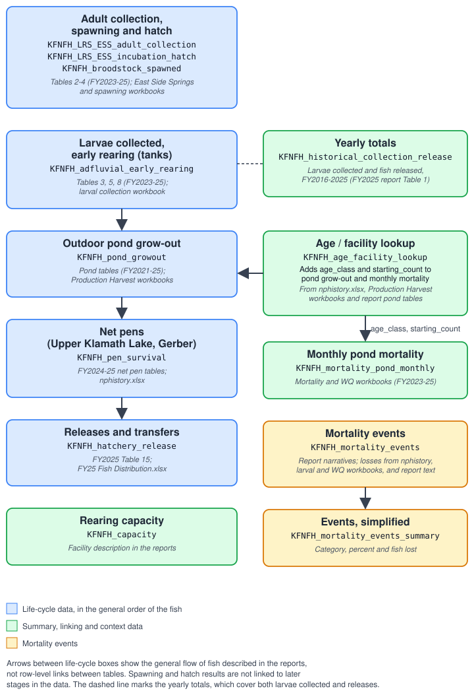

```{r setup, include = FALSE}
knitr::opts_chunk$set(collapse = TRUE, comment = "#>", fig.width = 6.5, fig.height = 3.8, dpi = 96,
                      message = FALSE, warning = FALSE)
library(klamathFishData)
library(dplyr)
library(tidyr)
library(stringr)
library(purrr)
library(ggplot2)
library(knitr)

theme_set(theme_minimal(base_size = 11))

# first rows of an object as a small table (first n columns so it fits the page)
peek <- function(x, cols = 6, rows = 5) {
  x |> select(1:min(cols, ncol(x))) |> head(rows) |> kable(format.args = list(big.mark = ","))
}
```

<div style="border-left: 6px solid #d9822b; background: #fdf3e7; padding: 0.7em 1em; margin: 1em 0;">
**&#9888; Preliminary data.** All data aggregations are preliminary and need to be QC'd by KFNFH.
</div>

# Purpose

This is a draft, basic tour of the data objects built from the Klamath Falls National Fish Hatchery (KFNFH) annual reports and
supporting Excel workbooks. For each object it shows what the object is, which reports and files it came from, what it looks
like, and one basic exploratory plot. The first section is an overview of the hatchery facilities.

KFNFH grew out of the Sucker Assisted Rearing Program (SARP), a pilot that reared wild-caught larval Lost River and shortnose
suckers in ponds from 2016. USFWS designated the site as a National Fish Hatchery in early 2022 (FY2024 report, p. 5). Both names appear in the
reports for the same effort. All data cover federal fiscal years (1 October to 30 September).

The objects are built by `data-raw/processing-scripts/process-hatchery-data.R`. The checks behind each object are in
`data-raw/hatchery_data_integration.Rmd`, and every column is described in `data-raw/hatchery_data_dictionary.csv`.

# Data objects at a glance

```{r overview-table}
objects <- c("KFNFH_historical_collection_release", "KFNFH_hatchery_release", "KFNFH_LRS_ESS_adult_collection",
             "KFNFH_LRS_ESS_incubation_hatch", "KFNFH_adfluvial_early_rearing", "KFNFH_pond_growout",
             "KFNFH_pen_survival", "KFNFH_age_facility_lookup", "KFNFH_mortality_events",
             "KFNFH_mortality_events_summary", "KFNFH_mortality_pond_monthly", "KFNFH_capacity",
             "KFNFH_broodstock_spawned")

tibble(object = objects,
       rows = map_int(objects, ~ nrow(get(.x))),
       columns = map_int(objects, ~ ncol(get(.x)))) |>
  kable(format.args = list(big.mark = ","))
```

# How the data fit together

Draft diagram of the data objects. The top row follows the general flow of fish through the hatchery as described in the reports; the other
objects summarise, link or give context to it. Each box names the reports and files the object was built from.

```{r workflow, echo = FALSE, out.width = "100%", fig.alt = "Workflow diagram of the KFNFH data objects"}

```

# Facilities overview

This section uses `KFNFH_capacity` (how much rearing space each year) and `KFNFH_age_facility_lookup` (which pond or net pen held
which age class of fish each year).

## Station layout

What the reports say about the facilities:

* **Outdoor ponds.** In FY2024 the outdoor facility was 22 0.03-acre ponds in the P-series and four 0.25-acre ponds in the A-series,
  and the four A-series ponds were demolished early in FY2024 for construction (FY2024 report, p. 7). The finished hatchery is planned to have
  33 production ponds, about 8.5 acres of rearing space (FY2024 report, p. 5).
* **Indoor facility.** Tanks for larval rearing and for processing hatchery fish are in a greenhouse (FY2024 report, p. 7). A second indoor building is first described in the
  FY2025 report.
* **Net pens.** Fish are also grown out in net pens in Upper Klamath Lake (`UKL` pens) and at Gerber Reservoir (`GER` pens).

The B-series and C-series names are those used in the report pond and culture-unit tables.

```{r facility-series}
KFNFH_age_facility_lookup |>
  mutate(series = case_when(str_detect(facility, "^UKL") ~ "Upper Klamath Lake net pens",
                            str_detect(facility, "^GER") ~ "Gerber net pens",
                            TRUE ~ paste0(str_sub(facility, 1, 1), "-series ponds/units"))) |>
  group_by(series) |>
  summarise(facilities = n_distinct(facility),
            first_fy = min(fiscal_year),
            last_fy = max(fiscal_year),
            examples = paste(head(str_sort(unique(facility), numeric = TRUE), 4), collapse = ", ")) |>
  kable()
```

## Capacity over time

```{r capacity-plot, fig.height = 3.2}
KFNFH_capacity |>
  pivot_longer(c(n_outdoor_ponds, acreage_outdoor_ponds, gallons_indoor), names_to = "measure", values_to = "value") |>
  mutate(measure = recode(measure, n_outdoor_ponds = "Outdoor ponds (n)", acreage_outdoor_ponds = "Outdoor pond area (acres)",
                          gallons_indoor = "Indoor tanks (gallons)")) |>
  ggplot(aes(fiscal_year, value, shape = capacity_type)) +
  geom_point(size = 2.5) +
  geom_line(aes(group = 1), colour = "grey60") +
  facet_wrap(~ measure, scales = "free_y", nrow = 1) +
  labs(x = "Fiscal year", y = NULL, shape = NULL,
       title = "Rearing capacity by year (2028 is the planned build-out)")
```

## Which facility held which age class

Each square is one facility in one fiscal year, coloured by the youngest age class listed for that facility
(`KFNFH_age_facility_lookup$age_class`; for example "0/1" is shown as 0). Age classes are the fiscal year minus the collection year of the lot.
Facility-years with no record have no square.

```{r occupancy, fig.height = 8, fig.width = 6.5}
occ <- KFNFH_age_facility_lookup |>
  mutate(youngest = str_extract(age_class, "^[0-9]|^wild|^other"),
         youngest = factor(youngest, levels = c("0", "1", "2", "3", "4", "wild", "other")),
         facility = factor(facility, levels = rev(str_sort(unique(facility), numeric = TRUE))))

ggplot(occ, aes(factor(fiscal_year), facility, fill = youngest)) +
  geom_tile(colour = "white") +
  scale_fill_viridis_d(na.value = "grey85", drop = FALSE) +
  labs(x = "Fiscal year", y = NULL, fill = "Youngest\nage class",
       title = "Facility occupancy by fiscal year") +
  theme(panel.grid = element_blank(), axis.text.y = element_text(size = 6))
```

# Collection and release history

## `KFNFH_historical_collection_release`

Larvae collected and fish released by type (SARP, fingerling, fry, salvage) for each fiscal year since 2016.

**Source:** Table 1 of the FY2025 annual report; broodstock numbers from the report text; the collection totals agree with
`2025 Larval Collection and Early Rearing Summary Data (version 1).xlsx`. FY2016 to FY2025.

```{r hist-peek}
peek(KFNFH_historical_collection_release, cols = 6)
```

```{r hist-plot}
KFNFH_historical_collection_release |>
  select(fiscal_year, larvae_collected, total_released) |>
  pivot_longer(-fiscal_year) |>
  mutate(name = recode(name, larvae_collected = "Larvae collected", total_released = "Total released")) |>
  ggplot(aes(fiscal_year, value, colour = name)) +
  geom_line() + geom_point() +
  scale_x_continuous(breaks = 2016:2025) +
  scale_y_continuous(labels = scales::label_comma()) +
  labs(x = "Fiscal year", y = "Fish", colour = NULL, title = "Larvae collected and fish released")
```

## `KFNFH_hatchery_release`

Every distribution or transfer of fish (date, species, lot, number, size, source pond and destination).

**Source:** FY2025 Table 15 of the annual report, which matches `FY25 Fish Distribution.xlsx`. FY2025 only in this draft.

```{r rel-peek}
KFNFH_hatchery_release |> select(dispo_date, species, lot, number_fish, from_ponds, dispo_location) |> head(5) |> kable(format.args = list(big.mark = ","))
```

```{r rel-plot}
KFNFH_hatchery_release |>
  filter(!is.na(number_fish), number_fish > 0) |>
  ggplot(aes(dispo_date, number_fish, colour = species)) +
  geom_point(alpha = 0.7) +
  scale_y_log10(labels = scales::label_comma()) +
  labs(x = NULL, y = "Fish per release (log scale)", colour = NULL, title = "FY2025 releases and transfers")
```

# Spawning and early life stages

## `KFNFH_LRS_ESS_adult_collection`

Wild adult Lost River suckers collected at East Side Springs: date, PIT tag, sex, use of gametes, lengths and spring.

**Source:** Table 2 of the FY2023 to FY2025 reports; FY2023 and FY2024 match the East Side Springs metadata workbooks.

```{r ess-peek}
KFNFH_LRS_ESS_adult_collection |> select(fiscal_year, date, sex, gamete_use, fl_mm, spring_location) |> head(5) |> kable()
```

```{r ess-plot}
KFNFH_LRS_ESS_adult_collection |>
  count(fiscal_year, sex) |>
  ggplot(aes(factor(fiscal_year), n, fill = sex)) +
  geom_col(position = position_dodge2(preserve = "single")) +
  labs(x = "Fiscal year", y = "Adults collected", fill = NULL, title = "Wild adults collected at East Side Springs")
```

## `KFNFH_LRS_ESS_incubation_hatch`

Spawning crosses per female and incubation vessel: parents, family groups, eggs, fry and hatch percent.

**Source:** Table 3 of the FY2024 and FY2025 reports; both years match the East Side Springs metadata workbooks.

```{r inc-peek}
KFNFH_LRS_ESS_incubation_hatch |> select(fiscal_year, spawning_date, incubator, total_eggs, total_fry, hatch_percent) |> head(5) |> kable(format.args = list(big.mark = ","))
```

```{r inc-plot}
ggplot(KFNFH_LRS_ESS_incubation_hatch, aes(hatch_percent)) +
  geom_histogram(binwidth = 10, boundary = 0, fill = "grey40", colour = "white") +
  facet_wrap(~ fiscal_year, ncol = 1) +
  labs(x = "Hatch (%)", y = "Incubation vessels", title = "Hatch percent by incubation vessel",
       caption = "Values above 100% are as reported.")
```

## `KFNFH_adfluvial_early_rearing`

Larval stocking into culture units (tanks): number collected, mortality, number stocked and survival. `restock` flags larvae moved back into a unit already in use.

**Source:** FY2023 Table 3, FY2024 Table 5 and FY2025 Table 8; FY2024 is identical to the early rearing workbook.

```{r early-peek}
KFNFH_adfluvial_early_rearing |> select(fiscal_year, date, culture_unit, collected, stocked, survival_percent) |> head(5) |> kable()
```

```{r early-plot}
ggplot(KFNFH_adfluvial_early_rearing, aes(collected, stocked, colour = factor(fiscal_year))) +
  geom_abline(slope = 1, intercept = 0, linetype = "dashed", colour = "grey60") +
  geom_point(alpha = 0.8) +
  scale_x_continuous(labels = scales::label_comma()) +
  scale_y_continuous(labels = scales::label_comma()) +
  labs(x = "Larvae collected into the unit", y = "Larvae stocked out", colour = "Fiscal year",
       title = "Early rearing per culture unit (dashed line: no loss)")
```

## `KFNFH_broodstock_spawned`

Captive broodstock spawned in spring 2025 by capture year, species and sex.

**Source:** `FY25CaptiveBroodSpawning_FINAL.xlsx` (sheet All PIT), identical to FY2025 Table 4.

```{r brood-peek}
KFNFH_broodstock_spawned |> select(species, capture_year, females_spawned, males_spawned, total_spawned) |> kable()
```

```{r brood-plot}
KFNFH_broodstock_spawned |>
  mutate(capture = coalesce(as.character(capture_year), "not recorded")) |>
  pivot_longer(c(females_spawned, males_spawned), names_to = "sex", values_to = "n") |>
  mutate(sex = recode(sex, females_spawned = "Female", males_spawned = "Male")) |>
  ggplot(aes(capture, n, fill = sex)) +
  geom_col(position = position_dodge2(preserve = "single")) +
  facet_wrap(~ species) +
  labs(x = "Capture year", y = "Fish spawned", fill = NULL, title = "Captive broodstock spawned in 2025")
```

# Rearing and survival

## `KFNFH_pond_growout`

One row per pond cycle: dates, numbers, weights, lengths, growth, harvest mortality, survival, disposition, `age_class` and `starting_count`.

**Source:** pond tables of the FY2021 to FY2025 annual reports; FY2025 cycles are checked against the Production Harvest workbook.
A cycle listed in two consecutive reports is kept once (the later report's row).

```{r pond-peek}
KFNFH_pond_growout |> select(fiscal_year, pond, lot, start_number, end_number, survival_percent) |> head(5) |> kable(format.args = list(big.mark = ","))
```

```{r pond-plot}
KFNFH_pond_growout |>
  filter(start_number > 0, end_number > 0) |>
  ggplot(aes(start_number, end_number, colour = factor(fiscal_year))) +
  geom_abline(slope = 1, intercept = 0, linetype = "dashed", colour = "grey60") +
  geom_point(alpha = 0.7) +
  scale_x_log10(labels = scales::label_comma()) +
  scale_y_log10(labels = scales::label_comma()) +
  labs(x = "Fish at start of cycle", y = "Fish at harvest", colour = "Fiscal year",
       title = "Pond cycles: start and end numbers (log scales, dashed line: no change)",
       caption = "Points above the line are cycles where more fish were counted at harvest than at the start, as reported.")
```

## `KFNFH_pen_survival`

Net pen survival and growth in Upper Klamath Lake and at Gerber Reservoir, with notes for years a pen was not operated.

**Source:** FY2024 Tables 9 and 10 and FY2025 Tables 13 and 14; identical to `nphistory.xlsx`. Operation years 2019 to 2025.

```{r pen-peek}
KFNFH_pen_survival |> select(pen_type, operation_year, pen_id, number_stocked, number_harvested, survival_percentage) |> head(5) |> kable()
```

```{r pen-plot}
KFNFH_pen_survival |>
  filter(!is.na(survival_percentage)) |>
  ggplot(aes(operation_year, survival_percentage, colour = pen_id)) +
  geom_point(size = 2) +
  facet_wrap(~ pen_type) +
  scale_x_continuous(breaks = 2019:2025) +
  labs(x = "Operation year", y = "Survival (%)", colour = "Pen", title = "Net pen survival")
```

## `KFNFH_age_facility_lookup`

Age class and starting count of the fish in each pond or net pen by fiscal year (plotted in the facilities overview above).

**Source:** net pens from `nphistory.xlsx`; ponds from the Production Harvest workbooks and the report pond tables. FY2019 to FY2025.

```{r lookup-peek}
peek(KFNFH_age_facility_lookup, cols = 5)
```

# Mortality

## `KFNFH_mortality_events` and `KFNFH_mortality_events_summary`

Mortality and near-miss events described in the report narratives: category, location, cause, loss, confidence, severity tier, the phrase in the
report, and the report and page (`citation`). The summary object keeps category, mortality yes/no, percent mortality and fish lost.

**Source:** events E01 to E28 are written from the FY2021 to FY2024 report narratives and tables; E29 to E37 from the FY2025 report, with losses
from `nphistory.xlsx`, the larval rearing tables and workbook, `KFNFH_WQ_FY2025_2 (version 1).xlsx` and the Production Harvest workbook where the report gives them.
Events whose report gives no loss have no percent.

```{r mort-peek}
KFNFH_mortality_events |> select(event_id, year, category, percent_lost, severity_tier, citation) |> head(5) |> kable()
```

```{r mort-plot}
KFNFH_mortality_events_summary |>
  filter(!is.na(percent_mortality)) |>
  ggplot(aes(year, percent_mortality, colour = category)) +
  geom_jitter(width = 0.15, height = 0, size = 2.5) +
  scale_x_continuous(breaks = 2019:2025) +
  labs(x = "Year", y = "Loss (%)", colour = NULL,
       title = "Events with a reported loss",
       caption = "Events with no reported loss are not shown.")
```

## `KFNFH_mortality_pond_monthly`

Monthly pond mortality (and FY2023 harvest mortality) with age class.

**Source:** `Fiscal Year 23 WQ_Mortality reporting.xlsx`, `Copy of 2024_KFNFH_WQ.xlsx` and `KFNFH_WQ_FY2025_2 (version 1).xlsx`. FY2024 covers 1 January to 22 September only.

```{r pm-peek}
KFNFH_mortality_pond_monthly |> select(fiscal_year, month, pond, mortality, record_type, age_class) |> head(5) |> kable()
```

```{r pm-plot}
KFNFH_mortality_pond_monthly |>
  mutate(month = factor(month, levels = month.abb[c(10:12, 1:9)])) |>
  group_by(fiscal_year, month) |>
  summarise(mortality = sum(mortality, na.rm = TRUE), .groups = "drop") |>
  ggplot(aes(month, mortality, colour = factor(fiscal_year), group = fiscal_year)) +
  geom_line() + geom_point() +
  scale_y_continuous(labels = scales::label_comma()) +
  labs(x = NULL, y = "Fish recorded dead", colour = "Fiscal year",
       title = "Monthly pond mortality",
       caption = "FY2024 is a partial year.")
```

